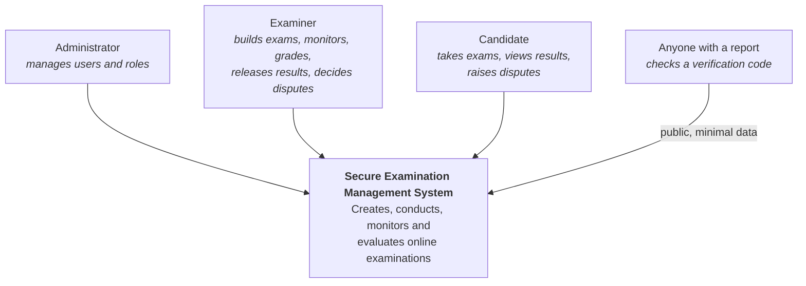
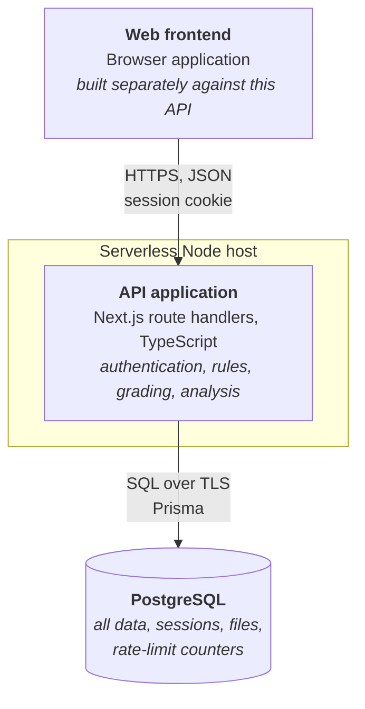
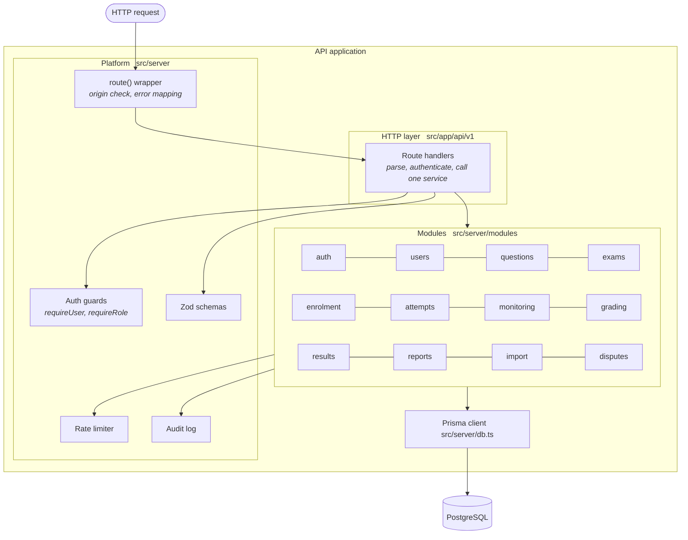
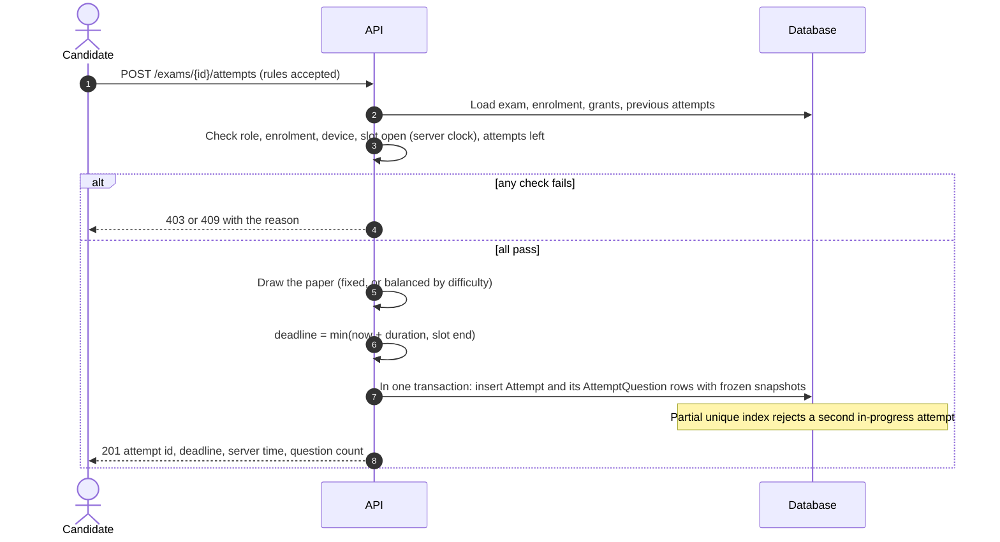
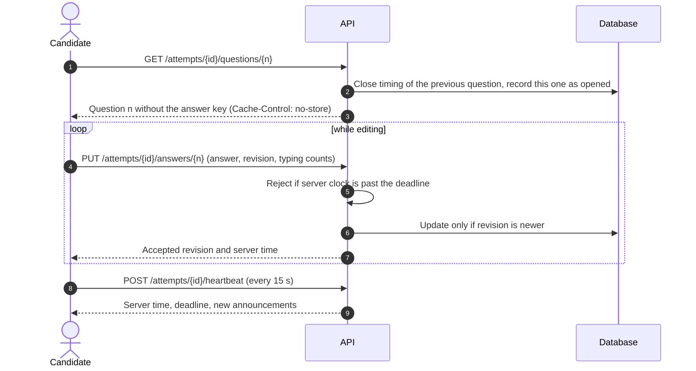
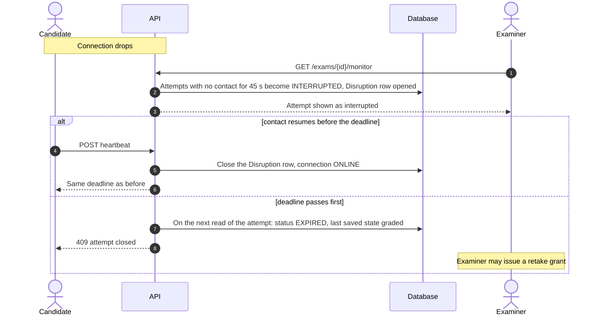
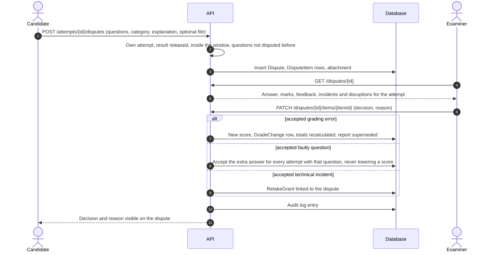
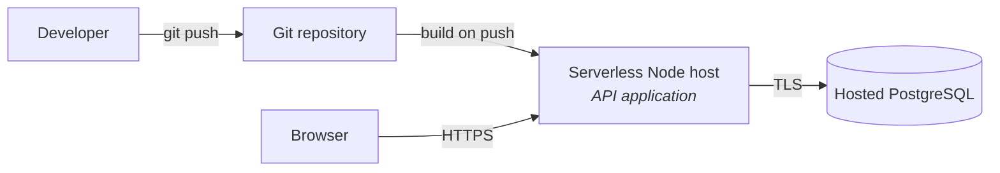

# Architecture

| | |
|---|---|
| Status | Agreed design. Foundation implemented; modules in progress |
| Structure | Sections follow arc42; diagrams follow the C4 model (context, container, component) |
| Related | [Data model](data-model.md), [API](api.md), [Security](security.md), [Decision records](adr/README.md) |

## 1. Goals

The system lets institutions create, conduct, monitor and evaluate online examinations. This repository is the backend: a JSON API that any frontend can consume.

Quality goals, in priority order:

| # | Goal | What it means here |
|---|---|---|
| 1 | Security | Every permission is enforced on the server. Answer keys never reach a candidate's browser |
| 2 | Integrity | Timing, attempts and grading cannot be influenced by the candidate's device |
| 3 | Reliability | Refreshes, retries, duplicate clicks and lost connections never corrupt or lose saved work |
| 4 | Fairness | Randomised papers are equally hard; disputes and disruptions are handled by transparent rules |
| 5 | Maintainability | One pattern for every module, so three people can work in parallel |

## 2. Constraints

| Constraint | Source |
|---|---|
| Built in 10 hours by 1 to 3 people | Competition |
| Must be deployed and demonstrable with test data | Brief, section 07 |
| No required feature may depend on a paid service or billing details | Brief, section 06 |
| Permissions enforced on the backend | Brief, 3.1 |
| Timing independent of the candidate's device clock | Brief, section 06 |
| Serverless hosting: no long-lived connections and no background workers | Chosen deployment target |

## 3. System context (C4 level 1)

Who uses the system and what it talks to.



There are no external systems. Email, video and AI services are deliberately not used, so no feature depends on a paid provider.

## 4. Containers (C4 level 2)

The deployable parts and how they communicate.



| Container | Technology | Responsibility |
|---|---|---|
| Web frontend | Any browser application | Presentation, exam-page restrictions, reporting integrity events |
| API application | Next.js 16 route handlers, TypeScript, Zod | Everything that must be trusted |
| Database | PostgreSQL 16 via Prisma 7 | Durable state and constraints |

The database also stores sessions, rate-limit counters and dispute attachments, so the system has exactly two moving parts. See [ADR 0001](adr/0001-stack.md).

## 5. Components (C4 level 3)

Inside the API application.



### Layering rules

| Layer | May do | Must not do |
|---|---|---|
| Route handler | Parse and validate input, check the role, call one service function, shape the response | Contain business rules or query the database |
| Service | Business rules, ownership checks, transactions | Read the request or build HTTP responses |
| Prisma client | Data access | Be imported by route handlers |

- Role checks ("is this an examiner?") live in the handler. Ownership checks ("is this *my* exam?") live in the service, next to the query.
- Services return plain objects built from explicit field lists. Password hashes and answer keys are never selected for a candidate-facing response.

### Modules

| Module | Responsibility | Brief |
|---|---|---|
| auth | Sign-in, sign-out, current user, password change, sessions | 3.1 |
| users | Administrator manages accounts, roles and activation | 3.1 |
| questions | Topics, questions, options, difficulty labels, archive | 3.3 |
| exams | Configuration, pool, difficulty mix, lifecycle, pre-publish review, rules for candidates | 3.2 |
| enrolment | Enrol candidates, retake grants, a candidate's exam list | 3.4 |
| attempts | Start, paper draw, question delivery, autosave, review flags, scratchpad, submit, expiry, sandbox | 3.5, 4.3, 4.8 |
| monitoring | Heartbeat, disruptions, incidents, announcements, live view | 3.6, 5.3 |
| grading | Automatic grading, manual grading, totals, score history | 3.7 |
| results | Release, candidate results, exam statistics, question analytics, fairness report | 3.8, 4.5, 5.2 |
| reports | PDF reports, verification code and QR, public verification | 4.2, 4.6 |
| import | Candidates and questions from CSV or JSON | 4.4 |
| disputes | Raise, review, decide, apply outcomes | 5.4 |
| integrity | Post-submission analysis and the integrity summary | 5.1 |
| workspace | Candidate preferences | 4.7 |

The network-aware interface (4.1) is a frontend feature. The backend supports it with a save acknowledgement that carries the accepted revision and the server time, and with the heartbeat.

## 6. Runtime views

### 6.1 Starting an attempt



### 6.2 Answering: one question at a time



The browser never holds more than the question on screen, and the server measures time per question itself. See [ADR 0006](adr/0006-one-question-at-a-time.md).

### 6.3 Deadline and disruption



The deadline never moves. Disruption records are evidence for the examiner, not a time adjustment. See [ADR 0005](adr/0005-server-deadline-no-time-credit.md).

### 6.4 Dispute



## 7. Code structure

```
prisma/
  schema.prisma            Data model
  migrations/              SQL migrations
  seed.ts                  Test accounts and demo data
src/
  app/api/v1/              HTTP layer: one folder per resource, one route.ts each
  server/
    db.ts                  Prisma client (single instance)
    env.ts                 Validated environment variables
    http/                  ApiError, response helpers, route() wrapper
    auth/                  Password hashing, sessions, guards
    security/              Rate limiting, origin check
    audit/                 Audit log writer
    modules/<module>/
      schemas.ts           Zod schemas for inputs
      service.ts           Business rules and data access
      policy.ts            Ownership and visibility rules (where needed)
docs/                      This documentation
```

## 8. Cross-cutting concepts

| Concern | Approach |
|---|---|
| Authentication | Opaque random session token in an `HttpOnly` cookie; only its hash is stored. See [ADR 0002](adr/0002-server-side-sessions.md) |
| Authorisation | Role guard in the handler, ownership check in the service, deny by default |
| Validation | Zod schema for every input; unknown fields rejected; the frontend validates again for usability |
| Errors | One error type mapped to a standard JSON shape; unexpected errors are logged and returned as a generic 500 |
| Time | Server clock only, UTC everywhere. Responses that matter for timing include the server time |
| Idempotency | Unique constraints and conditional updates make start, save and submit safe to repeat |
| Transactions | Every multi-row change runs in one database transaction |
| Auditing | Sensitive actions append a row to `AuditLog` in the same transaction |
| Rate limiting | Fixed-window counters in the database, so limits hold across serverless instances |
| Real-time needs | Polling and the heartbeat response. See [ADR 0011](adr/0011-polling-over-websockets.md) |
| Background work | None. Expired attempts are closed lazily on the next read; interrupted attempts are detected when the monitor is polled |
| Caching | API responses are `no-store` |

## 9. Deployment



| Item | Local | Production |
|---|---|---|
| Application | `npm run dev` | Serverless Node host, built on push |
| Database | PostgreSQL in Docker on port 5434 | Hosted PostgreSQL |
| Schema changes | `prisma migrate dev` | `prisma migrate deploy` during the build |
| Configuration | `.env` | Host environment variables |

Required configuration: `DATABASE_URL`. Optional: `ALLOWED_ORIGINS` when the frontend is served from a different origin.

## 10. Assumptions

| # | Assumption |
|---|---|
| S1 | The frontend is a separate browser application that consumes this API |
| S2 | When frontend and API share an origin, cookies work with no extra configuration. A different origin must be listed in `ALLOWED_ORIGINS` |
| S3 | Expected load is one institution: hundreds of concurrent candidates, not tens of thousands |
| S4 | A few seconds of delay in monitoring and announcements is acceptable |
| S5 | The host terminates HTTPS and passes the client address in `X-Forwarded-For` |
| S6 | Exam-page restrictions are enforced by the frontend and can be bypassed by a determined candidate; the server never relies on them |

Assumptions about exam rules are listed in the [data model](data-model.md#6-assumptions).

## 11. Known limitations

| Limitation | Why it is accepted |
|---|---|
| A second device pointed at the screen cannot be detected | Not possible from a browser; mitigated by different papers per candidate and server-side analysis |
| Screenshots cannot be prevented | The operating system takes them; the page watermark makes leaks traceable |
| An outage in the last moments can lose unsaved work on the open question | The deadline must not move; the examiner can issue a retake grant |
| Monitoring is delayed by the polling interval | Avoids long-lived connections on a serverless host |
| Files are stored in the database | Acceptable at 4 MB and low volume; avoids a storage service |
