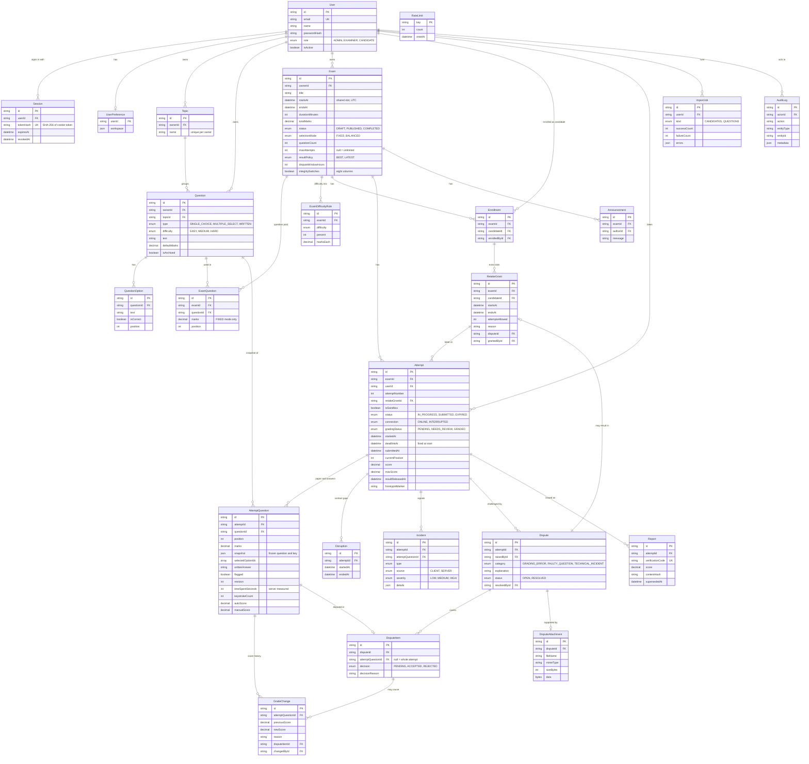
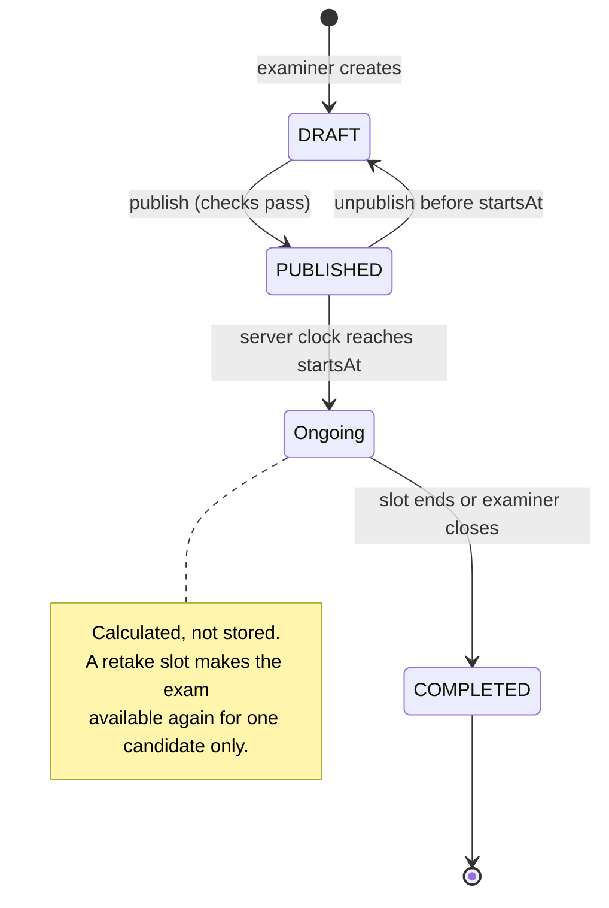
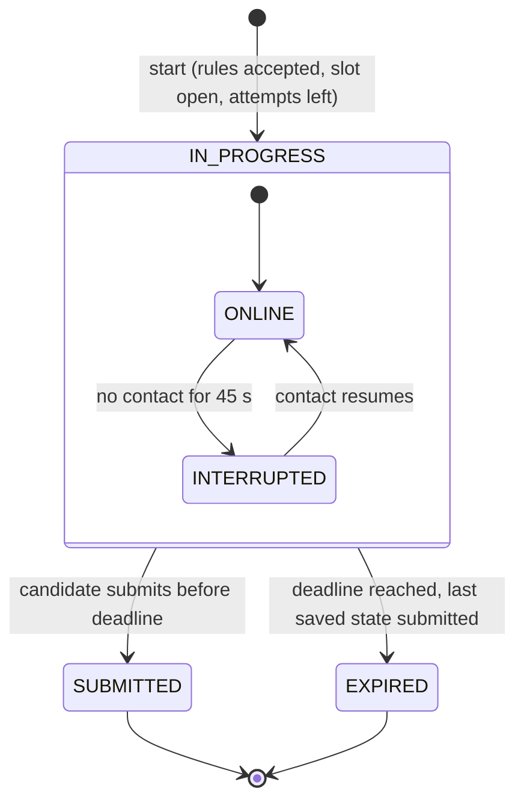
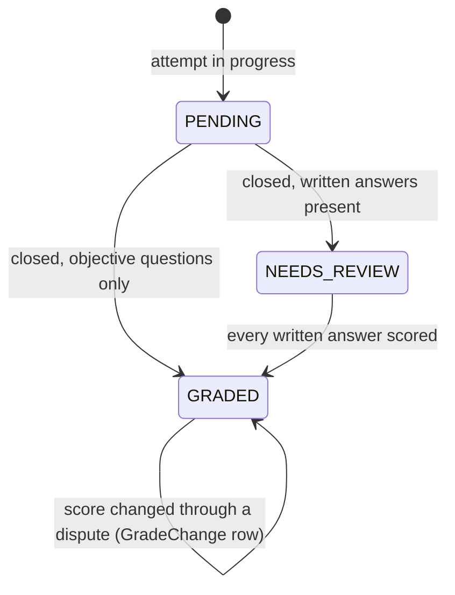
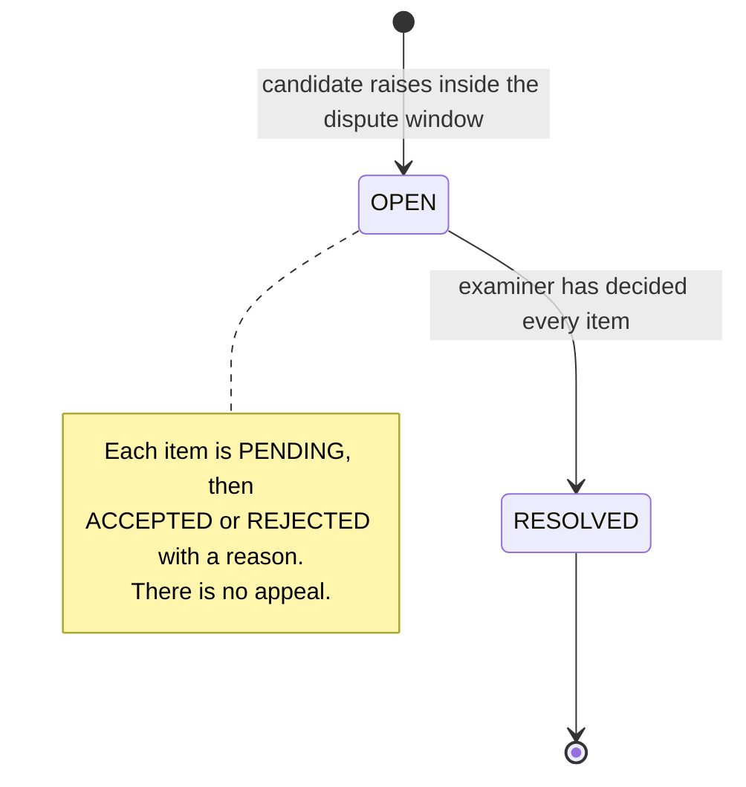

# Data model

| | |
|---|---|
| Status | Agreed design, applied as migration `init` |
| Database | PostgreSQL 16 |
| Source of truth | [`prisma/schema.prisma`](../prisma/schema.prisma) |
| Related | [Architecture](architecture.md), [Decision records](adr/README.md) |

## 1. Conventions

| Topic | Convention |
|---|---|
| Naming | Tables in `PascalCase` singular, columns in `camelCase`, as generated by Prisma |
| Keys | Text primary keys holding a cuid, generated by the application |
| Time | Every timestamp is `timestamptz` holding UTC. The API sends ISO 8601 UTC; clients convert for display |
| Marks | `numeric(7,2)`, so partial credit is exact |
| Enumerations | PostgreSQL enum types |
| Deletion | Records that carry history are never deleted. Questions are archived; users are deactivated |
| Flexible data | `jsonb` only where the shape varies by type (snapshot, incident details, preferences) and is validated by the application |

## 2. Entity-relationship diagram

The diagram shows the main columns of each table. Section 7 lists every column.

## 3. Table catalogue

| Group | Table | Purpose |
|---|---|---|
| Identity and access | `User` | A person who can sign in, with one role |
| | `Session` | A revocable signed-in session |
| | `UserPreference` | Candidate workspace settings |
| Question bank | `Topic` | Category in an examiner's bank |
| | `Question` | Reusable question with type and difficulty |
| | `QuestionOption` | Answer choice and answer key |
| Examinations | `Exam` | Slot, paper rules, attempt rules, integrity switches |
| | `ExamQuestion` | Question pool of an exam |
| | `ExamDifficultyRule` | Difficulty mix for balanced papers |
| | `Enrollment` | Which candidates may take which exam |
| | `RetakeGrant` | Extra slot for one candidate |
| Attempts and answers | `Attempt` | One sitting by one person |
| | `AttemptQuestion` | Frozen question, answer and score |
| | `GradeChange` | Score history |
| Monitoring and integrity | `Disruption` | Gap in contact with the exam page |
| | `Incident` | Integrity signal for review |
| | `Announcement` | Examiner message during an exam |
| Disputes | `Dispute` | Candidate's challenge to a result |
| | `DisputeItem` | One disputed question and its decision |
| | `DisputeAttachment` | Supporting document |
| Reports and operations | `Report` | Issued result with verification code |
| | `ImportJob` | Bulk import outcome |
| | `AuditLog` | Record of sensitive actions |
| | `RateLimit` | Abuse-limiting counters |

## 4. State models

### 4.1 Exam

`DRAFT`, `PUBLISHED` and `COMPLETED` are stored. **Ongoing** is calculated: the exam is ongoing while it is published and the server clock is inside the slot. See [ADR 0003](adr/0003-derived-ongoing-state.md).

### 4.2 Attempt

After an attempt closes, its grading status moves independently:

### 4.3 Dispute

## 5. Integrity rules enforced by the database

| Rule | Mechanism |
|---|---|
| One account per email | Unique index on `User.email` |
| A candidate is enrolled in an exam once | Unique `(examId, candidateId)` on `Enrollment` |
| A question is in an exam's pool once | Unique `(examId, questionId)` on `ExamQuestion` |
| One difficulty rule per level per exam | Unique `(examId, difficulty)` on `ExamDifficultyRule` |
| Attempt numbers do not repeat | Unique `(examId, userId, attemptNumber)` on `Attempt` |
| At most one attempt in progress per candidate per exam | Partial unique index on `Attempt (examId, userId)` where `status = 'IN_PROGRESS'` |
| A retake grant exists only for an enrolled candidate | Composite foreign key from `RetakeGrant` to `Enrollment` |
| A question is disputed at most once | Unique `DisputeItem.attemptQuestionId` |
| A paper has no duplicate questions or positions | Unique `(attemptId, questionId)` and `(attemptId, position)` |
| A slot ends after it starts | Check constraints on `Exam` and `RetakeGrant` |
| Scores stay between zero and the question's marks | Check constraints on `AttemptQuestion` |
| Attachments are at most 4 MB | Check constraint on `DisputeAttachment` |
| History survives | `Restrict` on deletes of users, questions and exams that are referenced |

Rules that span rows are enforced in the service layer inside a transaction: difficulty percentages summing to 100, a paper adding up to `totalMarks`, the attempt limit, and the dispute window.

## 6. Assumptions

| # | Assumption |
|---|---|
| A1 | A user has exactly one role. Someone who is both examiner and candidate needs two accounts |
| A2 | Anyone may sign up as a candidate or an examiner. Accounts are also created by an administrator or by an examiner's candidate import. An administrator account is never created by sign-up |
| A3 | A question bank belongs to one examiner and is reused across that examiner's exams. Banks are not shared between examiners |
| A4 | An exam has one slot that applies to every enrolled candidate. A different time for one candidate is a retake grant |
| A5 | A candidate may start any time inside the slot and gets the full duration or until the slot ends, whichever is earlier |
| A6 | The deadline never moves. There is no pause and no time credit. At the deadline the last state saved on the server is submitted |
| A7 | The examiner sets attempts per exam from 1 to unlimited and may change it later. Lowering it never removes attempts already made |
| A8 | With several attempts, the result is the best or the latest attempt, as the examiner chose. Candidates are told which |
| A9 | Every paper in balanced mode has the same number of easy, medium and hard questions and the same total marks |
| A10 | Difficulty is the examiner's label. Observed difficulty is reported after the exam but does not change scores |
| A11 | Only the exam's examiner decides disputes. There is no appeal |
| A12 | A dispute fix for a faulty question applies to every candidate who had that question, and no candidate loses marks from it |
| A13 | Integrity signals never change a score. The examiner reviews and decides |
| A14 | No camera, microphone or screen recording is collected |
| A15 | Exams are taken on a desktop browser. Other screens of the application work on any device |
| A16 | Supporting documents are small (4 MB) and few, so they are stored in the database |
| A17 | Each examiner works independently. Organisations, and sharing of banks or exams between examiners, are out of scope |
| A18 | Email addresses are not verified, because the system uses no email service |

## 7. Data dictionary

Generated from the live schema. Types are PostgreSQL types.

### Identity and access

#### `User`

A person who can sign in. Exactly one role each.

| Column | Type | Null | Default | Description |
|---|---|---|---|---|
| `id` | text | no |  | Primary key (cuid). |
| `email` | text | no |  | Sign-in identifier. Stored lower-case. |
| `name` | text | no |  | Display name. |
| `passwordHash` | text | no |  | scrypt hash with its salt and parameters. Never returned by the API. |
| `role` | enum Role | no | `CANDIDATE` | ADMIN, EXAMINER or CANDIDATE. |
| `isActive` | boolean | no | `true` | False blocks sign-in and ends existing sessions. |
| `createdAt` | timestamptz | no | `now` | When the row was created. |
| `updatedAt` | timestamptz | no |  | When the row was last changed. |

Unique: `(email)`.

#### `Session`

A signed-in session. Stored on the server so it can be revoked.

| Column | Type | Null | Default | Description |
|---|---|---|---|---|
| `id` | text | no |  | Primary key (cuid). |
| `userId` | text | no |  | References `User`; deleted with it. |
| `tokenHash` | text | no |  | SHA-256 of the cookie token. The token itself is never stored. |
| `createdAt` | timestamptz | no | `now` | When the row was created. |
| `expiresAt` | timestamptz | no |  | Absolute expiry. |
| `lastSeenAt` | timestamptz | no | `now` | Last request made with this session. |
| `revokedAt` | timestamptz | yes |  | Set on logout, password change, role change, deactivation or a newer sign-in. |
| `ip` | text | yes |  | Network address at sign-in. |
| `userAgent` | text | yes |  | Browser identification at sign-in. |

Unique: `(tokenHash)`.

#### `UserPreference`

A candidate's exam workspace settings, kept across devices.

| Column | Type | Null | Default | Description |
|---|---|---|---|---|
| `userId` | text | no |  | References `User`; deleted with it. |
| `workspace` | jsonb | no | `{}` | Validated settings object: layout, font size, theme, palette position. |
| `updatedAt` | timestamptz | no |  | When the row was last changed. |

### Question bank

#### `Topic`

A category in an examiner's question bank.

| Column | Type | Null | Default | Description |
|---|---|---|---|---|
| `id` | text | no |  | Primary key (cuid). |
| `ownerId` | text | no |  | References `User`; blocks its deletion. |
| `name` | text | no |  | Unique within the owner's bank. |
| `createdAt` | timestamptz | no | `now` | When the row was created. |

Unique: `(ownerId, name)`.

#### `Question`

A reusable question in an examiner's bank.

| Column | Type | Null | Default | Description |
|---|---|---|---|---|
| `id` | text | no |  | Primary key (cuid). |
| `ownerId` | text | no |  | References `User`; blocks its deletion. |
| `topicId` | text | no |  | References `Topic`; blocks its deletion. |
| `type` | enum QuestionType | no |  | SINGLE_CHOICE, MULTIPLE_SELECT or WRITTEN. |
| `difficulty` | enum Difficulty | no |  | EASY, MEDIUM or HARD. Required label set by the examiner. |
| `text` | text | no |  | The question statement. |
| `explanation` | text | yes |  | Optional model answer or marking guidance. Examiner-only. |
| `defaultMarks` | numeric(7,2) | no |  | Marks suggested when the question is added to an exam. |
| `isArchived` | boolean | no | `false` | Hidden from new exams. Questions in use are archived, never deleted. |
| `createdAt` | timestamptz | no | `now` | When the row was created. |
| `updatedAt` | timestamptz | no |  | When the row was last changed. |

#### `QuestionOption`

An answer choice for a single-choice or multiple-select question.

| Column | Type | Null | Default | Description |
|---|---|---|---|---|
| `id` | text | no |  | Primary key (cuid). |
| `questionId` | text | no |  | References `Question`; deleted with it. |
| `text` | text | no |  | The choice shown to the candidate. |
| `isCorrect` | boolean | no | `false` | Part of the answer key. Never sent to a candidate. |
| `position` | integer | no |  | Authoring order. |

Unique: `(questionId, position)`.

### Examinations

#### `Exam`

An examination: its slot, paper rules, attempt rules and integrity switches.

| Column | Type | Null | Default | Description |
|---|---|---|---|---|
| `id` | text | no |  | Primary key (cuid). |
| `ownerId` | text | no |  | References `User`; blocks its deletion. |
| `title` | text | no |  | Exam name. |
| `instructions` | text | no |  | Free text shown to candidates before they start. |
| `startsAt` | timestamptz | no |  | Start of the slot shared by all enrolled candidates (UTC). |
| `endsAt` | timestamptz | no |  | End of the shared slot (UTC). No attempt runs past it. |
| `durationMinutes` | integer | no |  | Time allowed per attempt. |
| `totalMarks` | numeric(7,2) | no |  | Marks every paper adds up to. Checked before publishing. |
| `status` | enum ExamStatus | no | `DRAFT` | DRAFT, PUBLISHED or COMPLETED. Ongoing is calculated from the slot. |
| `selectionMode` | enum SelectionMode | no | `FIXED` | FIXED serves the whole pool; BALANCED draws a difficulty-balanced paper per attempt. |
| `questionCount` | integer | yes |  | BALANCED mode: questions per paper. |
| `shuffleQuestions` | boolean | no | `false` | Randomise question order per attempt. |
| `shuffleOptions` | boolean | no | `false` | Randomise option order per attempt. |
| `multiSelectScoring` | enum MultiSelectScoring | no | `ALL_OR_NOTHING` | ALL_OR_NOTHING or PARTIAL credit for multiple-select questions. |
| `maxAttempts` | integer | yes | `1` | Attempts allowed in the shared slot. Null means unlimited. |
| `resultPolicy` | enum ResultPolicy | no | `BEST` | BEST or LATEST attempt is the candidate's result. |
| `disputeWindowHours` | integer | yes | `72` | Hours after result release in which a dispute can be raised. Null disables disputes. |
| `revealAnswers` | boolean | no | `false` | Show correct answers to candidates after results are released. |
| `desktopOnly` | boolean | no | `true` | Refuse attempts started from a phone. |
| `blockClipboard` | boolean | no | `true` | Exam page blocks copy, cut and paste and reports attempts. |
| `blockContextMenu` | boolean | no | `true` | Exam page blocks right-click and inspect shortcuts and reports attempts. |
| `requireFullscreen` | boolean | no | `false` | Exam page requires full screen and reports exits. |
| `detectExtraDisplay` | boolean | no | `true` | Exam page reports a second display where the browser supports it. |
| `watermark` | boolean | no | `true` | Exam page overlays the candidate's identifier. |
| `aiNotice` | boolean | no | `true` | Each question carries a visible notice that AI assistants must not answer. |
| `honeypot` | boolean | no | `true` | Each question carries a hidden per-attempt marker instruction for AI assistants. |
| `publishedAt` | timestamptz | yes |  | When the exam was published. |
| `completedAt` | timestamptz | yes |  | When the exam was closed. |
| `resultsPublishedAt` | timestamptz | yes |  | First time results were released. |
| `createdAt` | timestamptz | no | `now` | When the row was created. |
| `updatedAt` | timestamptz | no |  | When the row was last changed. |

#### `ExamQuestion`

Membership of a question in an exam's pool.

| Column | Type | Null | Default | Description |
|---|---|---|---|---|
| `id` | text | no |  | Primary key (cuid). |
| `examId` | text | no |  | References `Exam`; deleted with it. |
| `questionId` | text | no |  | References `Question`; blocks its deletion. |
| `marks` | numeric(7,2) | yes |  | FIXED mode: marks for this question. Null in BALANCED mode. |
| `position` | integer | no |  | Order in the pool; paper order when not shuffled. |

Unique: `(examId, questionId)`.

#### `ExamDifficultyRule`

Balanced mode: the share and value of one difficulty level in every paper.

| Column | Type | Null | Default | Description |
|---|---|---|---|---|
| `id` | text | no |  | Primary key (cuid). |
| `examId` | text | no |  | References `Exam`; deleted with it. |
| `difficulty` | enum Difficulty | no |  | The level this rule covers. One rule per level per exam. |
| `percent` | integer | no |  | Share of the paper at this level. Rules for an exam sum to 100. |
| `marksEach` | numeric(7,2) | no |  | Marks for each question at this level. |

Unique: `(examId, difficulty)`.

#### `Enrollment`

Permission for a candidate to see and take an exam.

| Column | Type | Null | Default | Description |
|---|---|---|---|---|
| `id` | text | no |  | Primary key (cuid). |
| `examId` | text | no |  | References `Exam`; deleted with it. |
| `candidateId` | text | no |  | References `User`; deleted with it. |
| `enrolledById` | text | no |  | References `User`; blocks its deletion. |
| `createdAt` | timestamptz | no | `now` | When the row was created. |

Unique: `(examId, candidateId)`.

#### `RetakeGrant`

An extra slot issued to one candidate by the examiner.

| Column | Type | Null | Default | Description |
|---|---|---|---|---|
| `id` | text | no |  | Primary key (cuid). |
| `examId` | text | no |  | With candidateId, references the enrolment, so only enrolled candidates can receive a grant. References `Enrollment`; deleted with it. |
| `candidateId` | text | no |  | The candidate receiving the extra slot. References `Enrollment`; deleted with it. |
| `startsAt` | timestamptz | no |  | Start of the retake slot (UTC). |
| `endsAt` | timestamptz | no |  | End of the retake slot (UTC). |
| `attemptsAllowed` | integer | no | `1` | Attempts usable in this slot. |
| `reason` | text | no |  | Why the grant was issued. Shown in the audit trail. |
| `disputeId` | text | yes |  | The dispute this grant resolves, if any. References `Dispute`; cleared if it is deleted. |
| `grantedById` | text | no |  | References `User`; blocks its deletion. |
| `createdAt` | timestamptz | no | `now` | When the row was created. |
| `revokedAt` | timestamptz | yes |  | Set if the examiner withdraws an unused grant. |

Unique: `(disputeId)`.

### Attempts and answers

#### `Attempt`

One sitting of an exam by one person.

| Column | Type | Null | Default | Description |
|---|---|---|---|---|
| `id` | text | no |  | Primary key (cuid). |
| `examId` | text | no |  | References `Exam`; blocks its deletion. |
| `userId` | text | no |  | References `User`; blocks its deletion. |
| `attemptNumber` | integer | no |  | 1, 2, 3 ... per candidate per exam. |
| `retakeGrantId` | text | yes |  | The retake slot used. Null for the shared slot. References `RetakeGrant`; cleared if it is deleted. |
| `isSandbox` | boolean | no | `false` | Examiner preview. Excluded from results, statistics and reports. |
| `status` | enum AttemptStatus | no | `IN_PROGRESS` | IN_PROGRESS, SUBMITTED (by the candidate) or EXPIRED (closed by the server at the deadline). |
| `connection` | enum ConnectionState | no | `ONLINE` | ONLINE or INTERRUPTED, from the heartbeat. |
| `gradingStatus` | enum GradingStatus | no | `PENDING` | PENDING, NEEDS_REVIEW (written answers waiting) or GRADED. |
| `startedAt` | timestamptz | no | `now` | Server time the attempt began. |
| `deadlineAt` | timestamptz | no |  | Fixed at start: the earlier of start plus duration and the slot end. Never moved. |
| `submittedAt` | timestamptz | yes |  | Server time the attempt was closed. |
| `lastSeenAt` | timestamptz | no | `now` | Last heartbeat or request from the exam page. |
| `rulesAcceptedAt` | timestamptz | no |  | When the candidate accepted the exam rules. |
| `currentPosition` | integer | no | `1` | Question currently on screen, for resuming. |
| `currentOpenedAt` | timestamptz | yes |  | When the server delivered the current question. |
| `score` | numeric(7,2) | yes |  | Total awarded. Null until graded. |
| `maxScore` | numeric(7,2) | no |  | Total available on this paper. |
| `resultReleasedAt` | timestamptz | yes |  | When the examiner released this result. Starts the dispute window. |
| `honeypotMarker` | text | yes |  | Unique word hidden in this attempt's questions. |
| `scratchpad` | text | no |  | The candidate's rough work. |
| `ip` | text | yes |  | Network address at start. |
| `userAgent` | text | yes |  | Browser identification at start. |
| `integrityReviewNote` | text | yes |  | The examiner's conclusion after reviewing the signals. |
| `integrityReviewedById` | text | yes |  | References `User`; cleared if it is deleted. |
| `integrityReviewedAt` | timestamptz | yes |  | When the review was recorded. |

Unique: `(examId, userId, attemptNumber)`; `(examId, userId where status = IN_PROGRESS)`.

#### `AttemptQuestion`

One question served in an attempt: the frozen question, the answer and the score.

| Column | Type | Null | Default | Description |
|---|---|---|---|---|
| `id` | text | no |  | Primary key (cuid). |
| `attemptId` | text | no |  | References `Attempt`; deleted with it. |
| `questionId` | text | no |  | References `Question`; blocks its deletion. |
| `position` | integer | no |  | Order of this question in the paper. |
| `marks` | numeric(7,2) | no |  | Marks available for this question on this paper. |
| `snapshot` | jsonb | no |  | Frozen copy of the question text, options and accepted answers taken at start. |
| `optionOrder` | text[] | yes |  | Option ids in the order shown to this candidate. |
| `selectedOptionIds` | text[] | yes |  | The candidate's chosen options. |
| `writtenAnswer` | text | yes |  | The candidate's written response. |
| `flagged` | boolean | no | `false` | Marked for review by the candidate. |
| `revision` | integer | no | `0` | Autosave counter. A save with an older revision is ignored. |
| `savedAt` | timestamptz | yes |  | Server time of the last accepted save. |
| `firstOpenedAt` | timestamptz | yes |  | Server time the question was first delivered. |
| `openCount` | integer | no | `0` | How many times the question was opened. |
| `timeSpentSeconds` | integer | no | `0` | Time on screen, measured by the server. |
| `keystrokeCount` | integer | no | `0` | Typing count reported by the exam page. Count only. |
| `pasteCount` | integer | no | `0` | Paste events reported by the exam page. |
| `autoScore` | numeric(7,2) | yes |  | Score from automatic grading. |
| `manualScore` | numeric(7,2) | yes |  | Score given by the examiner. Overrides autoScore. |
| `feedback` | text | yes |  | Examiner's comment to the candidate. |
| `gradedById` | text | yes |  | References `User`; cleared if it is deleted. |
| `gradedAt` | timestamptz | yes |  | When the manual score was given. |

Unique: `(attemptId, position)`; `(attemptId, questionId)`.

#### `GradeChange`

History of every change to a score after it was first given.

| Column | Type | Null | Default | Description |
|---|---|---|---|---|
| `id` | text | no |  | Primary key (cuid). |
| `attemptQuestionId` | text | no |  | References `AttemptQuestion`; deleted with it. |
| `previousScore` | numeric(7,2) | yes |  | Score before the change. |
| `newScore` | numeric(7,2) | no |  | Score after the change. |
| `reason` | text | no |  | Required explanation. |
| `disputeItemId` | text | yes |  | The dispute decision that caused the change, if any. References `DisputeItem`; cleared if it is deleted. |
| `changedById` | text | no |  | References `User`; blocks its deletion. |
| `createdAt` | timestamptz | no | `now` | When the row was created. |

### Monitoring and integrity

#### `Disruption`

A period with no contact from the exam page.

| Column | Type | Null | Default | Description |
|---|---|---|---|---|
| `id` | text | no |  | Primary key (cuid). |
| `attemptId` | text | no |  | References `Attempt`; deleted with it. |
| `startedAt` | timestamptz | no |  | Last contact before the gap (server clock). |
| `endedAt` | timestamptz | yes |  | First contact after the gap. Null while still interrupted. |

#### `Incident`

An integrity signal for the examiner to review. Not proof of misconduct.

| Column | Type | Null | Default | Description |
|---|---|---|---|---|
| `id` | text | no |  | Primary key (cuid). |
| `attemptId` | text | no |  | References `Attempt`; deleted with it. |
| `attemptQuestionId` | text | yes |  | The question involved, where relevant. References `AttemptQuestion`; cleared if it is deleted. |
| `type` | enum IncidentType | no |  | What was observed. See the incident catalogue in docs/api.md. |
| `source` | enum IncidentSource | no |  | CLIENT (reported by the exam page) or SERVER (detected by analysis). |
| `severity` | enum Severity | no | `LOW` | LOW, MEDIUM or HIGH. Guides review order only. |
| `details` | jsonb | yes |  | Type-specific data, such as time away or similarity score. |
| `createdAt` | timestamptz | no | `now` | Server receive time. |

#### `Announcement`

A message from the examiner to candidates during an exam.

| Column | Type | Null | Default | Description |
|---|---|---|---|---|
| `id` | text | no |  | Primary key (cuid). |
| `examId` | text | no |  | References `Exam`; deleted with it. |
| `authorId` | text | no |  | References `User`; blocks its deletion. |
| `message` | text | no |  | Text shown to every candidate in the exam. |
| `createdAt` | timestamptz | no | `now` | When the row was created. |

### Disputes

#### `Dispute`

A candidate's challenge to their own released result.

| Column | Type | Null | Default | Description |
|---|---|---|---|---|
| `id` | text | no |  | Primary key (cuid). |
| `attemptId` | text | no |  | References `Attempt`; deleted with it. |
| `raisedById` | text | no |  | References `User`; blocks its deletion. |
| `category` | enum DisputeCategory | no |  | GRADING_ERROR, FAULTY_QUESTION or TECHNICAL_INCIDENT. |
| `explanation` | text | no |  | The candidate's statement. |
| `status` | enum DisputeStatus | no | `OPEN` | OPEN until every item has a decision, then RESOLVED. |
| `createdAt` | timestamptz | no | `now` | When the row was created. |
| `resolvedAt` | timestamptz | yes |  | When the last item was decided. |
| `resolvedById` | text | yes |  | References `User`; cleared if it is deleted. |

#### `DisputeItem`

One disputed question (or the whole attempt) with its own decision.

| Column | Type | Null | Default | Description |
|---|---|---|---|---|
| `id` | text | no |  | Primary key (cuid). |
| `disputeId` | text | no |  | References `Dispute`; deleted with it. |
| `attemptQuestionId` | text | yes |  | The disputed question. Null covers the whole attempt. A question can be disputed once. References `AttemptQuestion`; deleted with it. |
| `candidateNote` | text | yes |  | Optional detail for this question. |
| `decision` | enum DisputeDecision | no | `PENDING` | PENDING, ACCEPTED or REJECTED. |
| `decisionReason` | text | yes |  | The examiner's written reason. Required to decide. |
| `decidedAt` | timestamptz | yes |  | When the decision was made. |

Unique: `(attemptQuestionId)`.

#### `DisputeAttachment`

Optional supporting document for a dispute.

| Column | Type | Null | Default | Description |
|---|---|---|---|---|
| `id` | text | no |  | Primary key (cuid). |
| `disputeId` | text | no |  | References `Dispute`; deleted with it. |
| `fileName` | text | no |  | Original name, sanitised. |
| `mimeType` | text | no |  | application/pdf, image/png or image/jpeg, verified from content. |
| `sizeBytes` | integer | no |  | File size. At most 4 MB. |
| `sha256` | text | no |  | Hash of the file for integrity. |
| `data` | bytea | no |  | The file content. |
| `createdAt` | timestamptz | no | `now` | When the row was created. |

Unique: `(disputeId)`.

### Reports and operations

#### `Report`

An issued result report with a public verification code.

| Column | Type | Null | Default | Description |
|---|---|---|---|---|
| `id` | text | no |  | Primary key (cuid). |
| `attemptId` | text | no |  | References `Attempt`; blocks its deletion. |
| `verificationCode` | text | no |  | Random public code, also encoded in the QR. |
| `score` | numeric(7,2) | no |  | Score at the time of issue. |
| `maxScore` | numeric(7,2) | no |  | Maximum at the time of issue. |
| `contentHash` | text | no |  | Hash of the report's content, to detect alteration. |
| `issuedById` | text | no |  | References `User`; blocks its deletion. |
| `issuedAt` | timestamptz | no | `now` | When the report was issued. |
| `supersededAt` | timestamptz | yes |  | Set when a newer report replaces this one after a score change. |
| `revokedAt` | timestamptz | yes |  | Set if the report is withdrawn. |

Unique: `(verificationCode)`.

#### `ImportJob`

The outcome of one bulk import, including row-level errors.

| Column | Type | Null | Default | Description |
|---|---|---|---|---|
| `id` | text | no |  | Primary key (cuid). |
| `userId` | text | no |  | References `User`; blocks its deletion. |
| `kind` | enum ImportKind | no |  | CANDIDATES or QUESTIONS. |
| `examId` | text | yes |  | Exam the candidates were enrolled into, if any. References `Exam`; cleared if it is deleted. |
| `fileName` | text | no |  | Name of the uploaded file. |
| `totalRows` | integer | no |  | Rows read. |
| `successCount` | integer | no |  | Rows imported. |
| `failureCount` | integer | no |  | Rows rejected. |
| `errors` | jsonb | no | `[]` | List of row, field and message for each rejected row. |
| `createdAt` | timestamptz | no | `now` | When the row was created. |

#### `AuditLog`

Append-only record of sensitive actions.

| Column | Type | Null | Default | Description |
|---|---|---|---|---|
| `id` | text | no |  | Primary key (cuid). |
| `actorId` | text | yes |  | Who did it. Null for system actions. References `User`; cleared if it is deleted. |
| `action` | text | no |  | What happened, such as USER_ROLE_CHANGED or RESULT_RELEASED. |
| `entityType` | text | no |  | Kind of record affected. |
| `entityId` | text | yes |  | The record affected. |
| `metadata` | jsonb | yes |  | Before and after values or other context. |
| `ip` | text | yes |  | Network address of the request. |
| `createdAt` | timestamptz | no | `now` | When the row was created. |

#### `RateLimit`

Request counters used to limit abuse.

| Column | Type | Null | Default | Description |
|---|---|---|---|---|
| `key` | text | no |  | What is being limited, such as login by address and email. |
| `count` | integer | no |  | Requests in the current window. |
| `resetAt` | timestamptz | no |  | When the window ends. |
