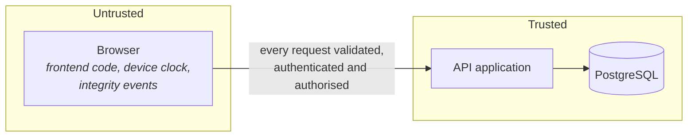

# Security

| | |
|---|---|
| Status | Agreed design. Authentication and user management are built; the Status column in each table says what else is |
| Method | Threat model by STRIDE; controls mapped to the OWASP Top 10 (2021) |
| Related | [Architecture](architecture.md), [ADR 0002](adr/0002-server-side-sessions.md), [ADR 0010](adr/0010-integrity-signals.md) |

Status values: **Built** means implemented and checked in this repository. **Planned** means designed and scheduled with its module.

## 1. Assets

| Asset | Why it matters |
|---|---|
| Answer keys | Exposure before or during an exam invalidates it |
| Credentials and sessions | Control of an account, especially examiner or administrator |
| Attempts, answers and scores | The outcome of the exam; must not be altered or lost |
| Personal information | Names, emails, results and uploaded documents |
| Exam timing | Extra time is an unfair advantage |
| Audit trail | Needed to resolve disputes and explain decisions |

## 2. Trust boundaries

Everything that arrives from the browser is untrusted, including the frontend's own restrictions and the events it reports. The server decides identity, permissions, time and scores.

## 3. Threat model (STRIDE)

| Category | Threat | Control | Status |
|---|---|---|---|
| Spoofing | Guessing or stuffing passwords | scrypt hashes; rate limit per address and per email; same error for unknown email and wrong password | Built |
| Spoofing | Stealing a session | `HttpOnly`, `SameSite`, `Secure` cookie; only the token hash is stored; 8-hour expiry; revoked on logout and password change | Built |
| Spoofing | Someone else taking the exam on a second device | A new sign-in ends the previous session and records an incident | Built (previous session ended); incident record Planned |
| Tampering | Changing an answer or score through the API | Ownership check on every write; saves rejected after the deadline; score changes only through grading or disputes, each recorded | Planned |
| Tampering | Sending `role` or another user's id in a request | Schemas reject unknown fields; identity comes from the session only | Built |
| Tampering | Changing the device clock to gain time | Deadline fixed at start and compared with the server clock | Planned |
| Tampering | Injection through input | Parameterised queries only; schema validation on every input; search terms treated as literal text; NUL characters and malformed ids refused before any query | Built for auth and users; per module after that |
| Repudiation | Denying a grade change, role change or dispute decision | Append-only audit log and `GradeChange` history with actor and reason | Built for sign-in and user changes; Planned for grading and disputes |
| Information disclosure | Answer keys reaching a candidate | Keys live in the attempt snapshot and are stripped from every candidate response; one question per request; no caching | Planned |
| Information disclosure | Reading another candidate's attempt or result by changing an id | Object-level check in every service; not-found for records the user may not see | Planned |
| Information disclosure | Internal details in error messages | Unexpected errors are logged and returned as a generic message | Built |
| Information disclosure | Personal data on the public verification page | Verification returns only validity, exam title, score and date; codes are random | Planned |
| Denial of service | Flooding sign-in, autosave or import | Database-backed rate limits; request size limits; pagination on lists | Built for sign-in and password change; Planned for the rest |
| Denial of service | Oversized request bodies | JSON bodies over 64 KB are refused with 413 | Built |
| Denial of service | Oversized or malicious uploads | 4 MB limit; PDF, PNG or JPEG only, verified from content; served as a download with `nosniff` | Planned |
| Elevation of privilege | Registering as an administrator, or sending extra fields on sign-up | Sign-up accepts only candidate or examiner and rejects unknown fields | Built |
| Spoofing | Bulk registration of fake accounts | Sign-up rate limit per address; administrators can deactivate accounts | Built |
| Elevation of privilege | Candidate calling examiner or administrator endpoints | Role guard on every handler; deny by default | Built for user management; per module after that |
| Elevation of privilege | Examiner acting on another examiner's exam | Ownership check in every service | Planned |
| Elevation of privilege | Cross-site request forgery | `SameSite` cookie and an origin check on every state-changing request | Built |

## 4. OWASP Top 10 (2021) mapping

| Risk | How it is addressed | Status |
|---|---|---|
| A01 Broken access control | Role guards, ownership checks, deny by default, no client-supplied identity | Built for user management; per module after that |
| A02 Cryptographic failures | scrypt for passwords, SHA-256 token hashes, HTTPS in production, no secrets in the repository | Built |
| A03 Injection | Prisma parameterised queries, Zod validation, no HTML rendering of user content by the API | Built (queries) |
| A04 Insecure design | Threat model, decision records, server-authoritative time, frozen papers, idempotent operations | Built (design) |
| A05 Security misconfiguration | Security headers, `no-store` API responses, no framework banner, generic errors | Built |
| A06 Vulnerable components | Lockfile committed; all dependencies audited on every pull request, which fails on a high-severity advisory | Built |
| A07 Identification and authentication failures | Rate-limited sign-in, revocable sessions, no default passwords outside seeded test accounts | Built |
| A08 Software and data integrity failures | Lockfile, migrations in version control, report content hashes | Built (lockfile, migrations) |
| A09 Logging and monitoring failures | Audit log for sensitive actions, readable by administrators with filters; server logs for unexpected errors | Built for sign-in and user changes; per module after that |
| A10 Server-side request forgery | The server makes no outbound requests | Built (by design) |

## 5. Examination integrity

These protect the exam itself and go beyond conventional application security.

| Control | Enforced by | Can a candidate switch it off? |
|---|---|---|
| Different, equally hard paper per candidate | Server | No |
| One question delivered at a time, never cached | Server | No |
| Fixed deadline on the server clock | Server | No |
| One attempt in progress; attempt limit | Server and database | No |
| One active session; new sign-in ends the old one | Server | No |
| Desktop-only check when an attempt starts | Server (best effort, from request headers) | With effort |
| Answer speed, typing counts versus answer length, similarity | Server analysis | No |
| Honeypot marker for AI assistants | Server inserts and checks | Only by noticing and removing it |
| Visible notice that AI assistants must not answer | Server inserts | No |
| Copy, cut, paste, right-click and shortcut blocking | Exam page | Yes, with developer tools |
| Leaving the window, tab or full screen; extra display | Exam page reports | Yes, by suppressing the report |
| Watermark with the candidate's identifier | Exam page | Yes, with developer tools |

Because the last group can be bypassed, the server treats those events as supporting signals and relies on the first group. A pasted answer, for example, is detected on the server from typing counts even if the paste block was disabled.

## 6. Privacy

- No camera, microphone or screen recording is collected.
- Typing is recorded as counts only, never as the keys pressed.
- Candidates are shown, before starting, every rule and everything that will be recorded.
- Integrity signals are visible to the exam's examiner only and are labelled as signals, not findings.
- The public verification page shows no email address and no answers.

## 7. Known gaps

| Gap | Position |
|---|---|
| A second device pointed at the screen | Not detectable from a browser |
| Screenshots | Cannot be prevented; the watermark makes leaks traceable |
| Email addresses are not verified, and sign-up reveals whether an address is registered | No email service is used; sign-up is rate-limited. See [ADR 0012](adr/0012-open-sign-up.md) |
| No automated dynamic security scan yet | To be run against the deployed application once endpoints exist |
